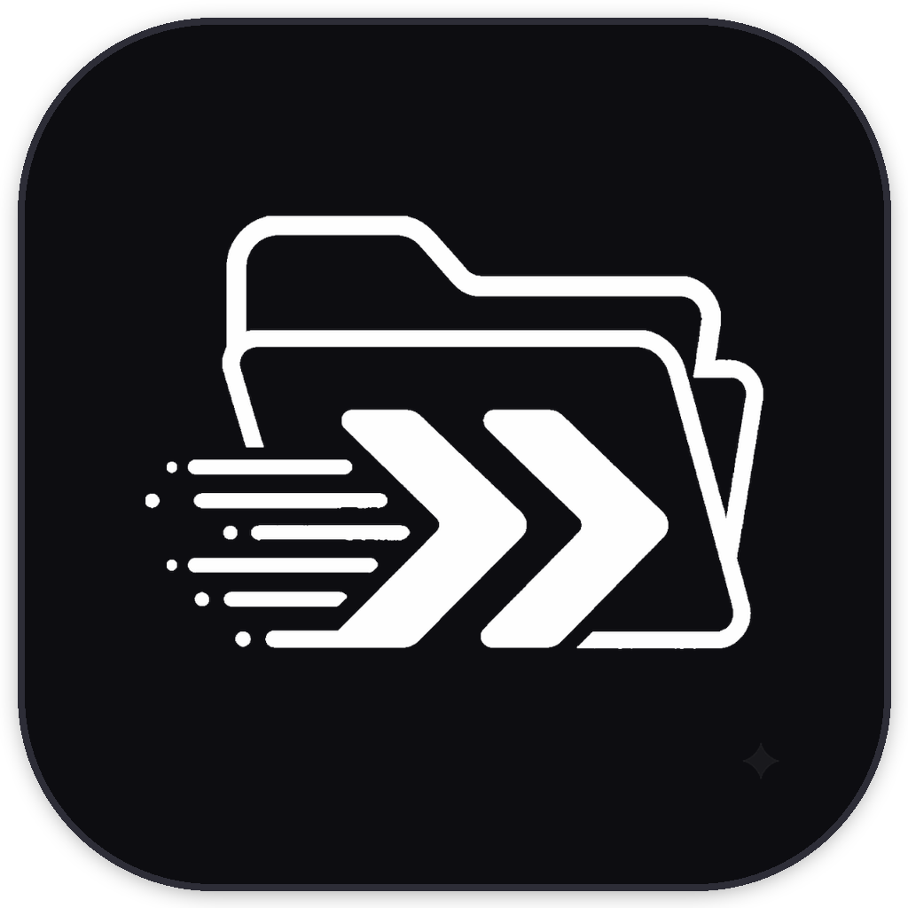
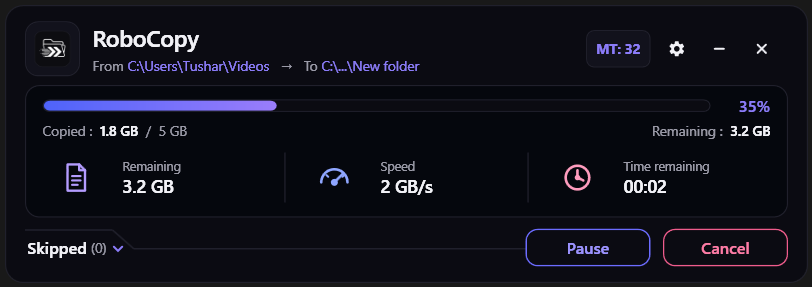
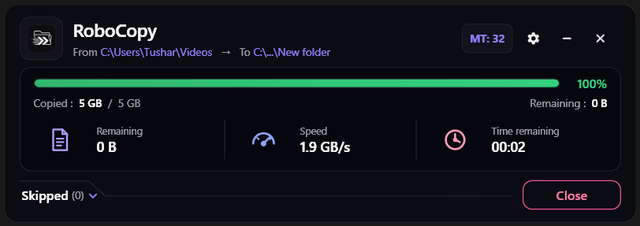
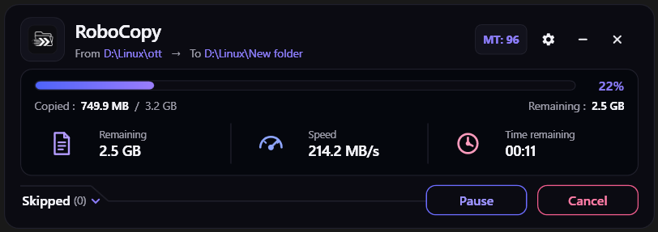
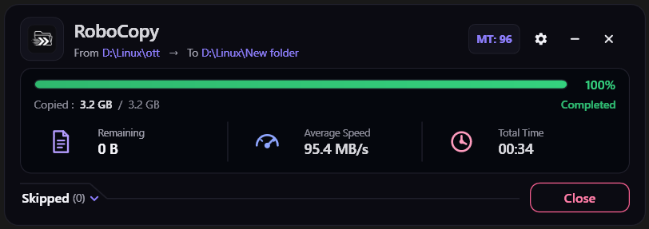
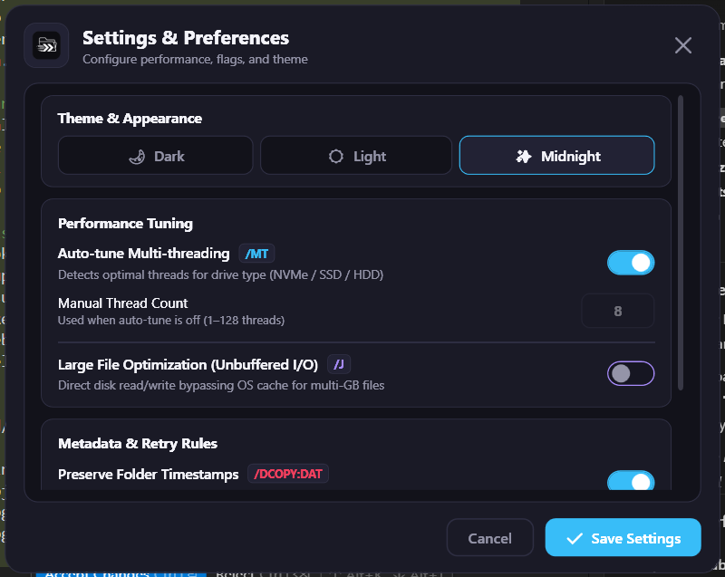
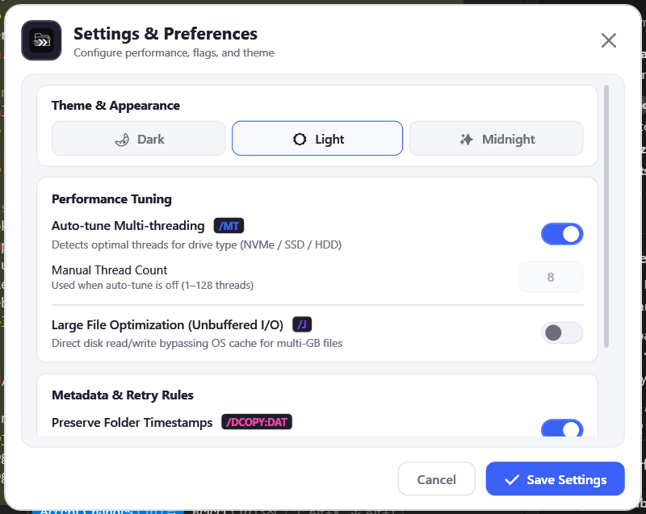
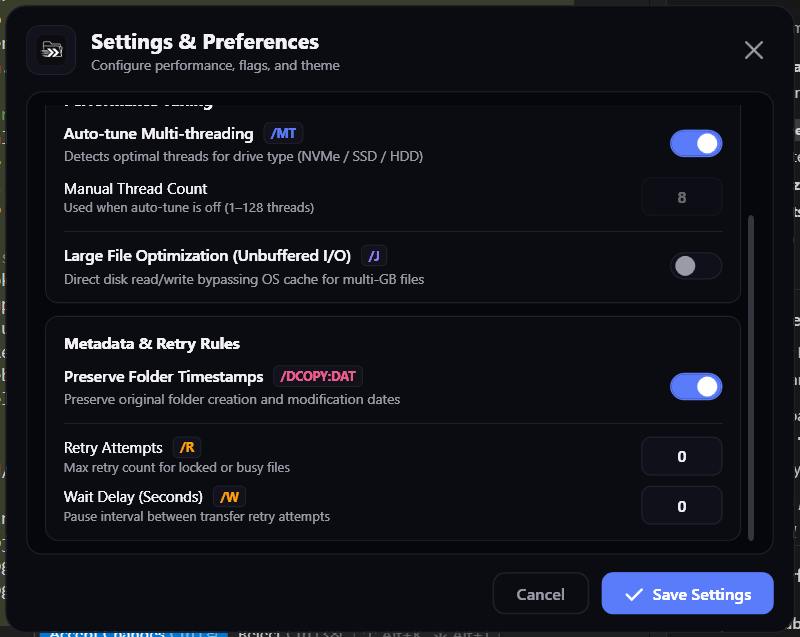

# 🚀 RoboCopyUI

<div align="center">



### *Next-Gen, Ultra-Fast Multi-Threaded File Transfer GUI for Windows*

[](#-key-features-breakdown)
[](https://dotnet.microsoft.com/)
[](#-tech-stack--requirements)
[](https://github.com/Snowail/RoboCopyUI/releases/tag/v1.7.3)
[](#-languages--personalization)
[](LICENSE)

<br/>

**RoboCopyUI** transforms Windows' enterprise-grade command-line tool (`robocopy.exe`) into an ultra-sleek, modern cyberpunk desktop utility. Put multi-threaded transfers, live progress, and configurable copy settings one keyboard shortcut away.

**📋 Copy with Ctrl+C · ✂️ Cut with Ctrl+X · 🚀 Paste with RoboCopyUI**

[⬇️ **Download 1.7.3 — Windows 11 x64 Installer**](https://github.com/Snowail/RoboCopyUI/releases/download/v1.7.3/RoboCopyUI-1.7.3-win-x64-setup.exe)

</div>

---

## 📦 Download & Install

Get the **complete Windows 11 x64 installer** from this fork's release page. It includes the .NET 10 desktop runtime, so you can install and start using RoboCopyUI right away.

| 📥 Download | 📄 Details |
| :--- | :--- |
| [🚀 Windows x64 Installer](https://github.com/Snowail/RoboCopyUI/releases/download/v1.7.3/RoboCopyUI-1.7.3-win-x64-setup.exe) | RoboCopyUI 1.7.3 with the desktop runtime included |
| [📦 Release Page](https://github.com/Snowail/RoboCopyUI/releases/tag/v1.7.3) | Release information and downloadable files |
| [🔎 SHA-256 Checksums](https://github.com/Snowail/RoboCopyUI/releases/download/v1.7.3/SHA256SUMS.json) | Verify your downloaded installer |

1. **📥 Download** and run the installer. This build is unsigned.
2. **⚙️ Open RoboCopyUI** from Start and read the first-run shortcut guide.
3. **📌 Find the tray icon** near the clock. Open settings, view tasks, pause shortcuts, or exit from here.
4. **📁 Open File Explorer** and use the copy-and-paste steps below.

The app installs for the current user. Before an upgrade, exit RoboCopyUI from the tray and wait for active tasks to finish.

---

## ⌨️ File Explorer Shortcuts — Copy, Cut & Paste

**Start with Windows' own Ctrl+C or Ctrl+X.** RoboCopyUI reads the files and copy/cut intent from the system clipboard when you invoke its paste shortcut.

### 📋 Copy Files & Folders

1. In **File Explorer**, select the files or folders you want to copy.
2. Press **Ctrl+C** to put that selection on the Windows clipboard.
3. Open the **destination folder** and click inside its **file list**.
4. Press **Ctrl+Alt+V** to start a RoboCopyUI copy.
5. Follow the transfer in the progress window. The originals stay in the source folder.

### ✂️ Move Files & Folders

1. In **File Explorer**, select the files or folders you want to move.
2. Press **Ctrl+X** to mark that selection for moving.
3. Open the **destination folder** and click inside its **file list**.
4. Press **Ctrl+Alt+V** to start a RoboCopyUI move.
5. Source cleanup follows successful copying and verification. Review the task window if any items remain.

### 🛡️ Choose Full Preservation for This Paste

Use **Ctrl+C** or **Ctrl+X** first, navigate to the destination, then press **Ctrl+Alt+Shift+V**.

This requests **full preservation for that one paste**. The clipboard still determines whether the operation copies or moves the selection.

| 🧩 Option | 📂 What it does |
| :--- | :--- |
| `/ZB` | Uses restartable copying and attempts backup mode if access is denied |
| `/COPYALL` | Requests file data, attributes, timestamps, permissions, ownership, and auditing information |
| `/DCOPY:DAT` | Requests directory data, attributes, and timestamps |
| `/E` | Includes subdirectories and empty directories when copying a selected folder |

The destination must support the requested metadata, and your account needs the required permissions. If full preservation fails, the task window explains the error and offers the applicable retry options.

### 🗑️ Permanently Delete a Selection

Select the items in File Explorer and press **Ctrl+Alt+D**. Review the selection and confirm deletion. **Cancel is selected by default**, and confirmed deletion skips the Recycle Bin.

### 🎯 Shortcut Reference

| Shortcut | Action |
| :--- | :--- |
| **Ctrl+C** | 📋 Windows copies the selected files to the system clipboard |
| **Ctrl+X** | ✂️ Windows marks the selected files for moving |
| **Ctrl+Alt+V** | 🚀 RoboCopyUI pastes with ordinary copy settings |
| **Ctrl+Alt+Shift+V** | 🛡️ RoboCopyUI pastes with full preservation for this task |
| **Ctrl+Alt+D** | 🗑️ Opens permanent-delete confirmation for the selection |

**⚙️ Make the keys yours.** Change, clear, or restore each RoboCopyUI shortcut in settings. Use the tray's pause control when needed.

**📍 Focus matters.** RoboCopyUI shortcuts act in the Explorer file list. Address bars, search fields, file-renaming boxes, and other applications keep their own keyboard behavior. Keep RoboCopyUI running in the tray while using its shortcuts. **Ctrl+V** continues to invoke Windows' normal paste operation.

---

## ⚡ Peak Velocity Showcase

The original project's transfer showcase captures **5 GB transferred in approximately 2 seconds**, with displayed speeds reaching **2.0 GB/s**.

<div align="center">
  
</div>

<br/>

<div align="center">
  
</div>

---

## 📊 Dual Real-World Benchmarks

Explore the original project's large-file and small-file showcases. Transfer speed depends on your drives, connection, selected options, and workload.

### 1. 🏎️ Large File Raw Velocity — 5 GB Transfer

- **📁 File size** — 5.0 GB.
- **⚡ Displayed transfer speed** — 1.9–2.0 GB/s.
- **⏱️ Completion time** — approximately 2 seconds.
- **🏎️ Large-file option** — `/J` unbuffered I/O.

### 2. ⚡ Small-Files Stress Test — 50,000+ Files

<div align="center">
  
</div>

- **📂 Workload** — 50,000+ small files, 3.2 GB total.
- **🧵 Threads** — 96 parallel workers.
- **🚀 Peak burst** — 214.2 MB/s.
- **📊 Average speed** — 95.4 MB/s.
- **⏱️ Completion time** — 34 seconds.

<div align="center">
  
</div>

---

## 🎨 Themes & Customization

Choose **Midnight (Cyber Dark)**, **Clean Light**, or **Classic Dark** to match your desktop. Theme previews from the original project are shown below.

| 🌌 Midnight Theme | ☀️ Clean Light Theme | 🌙 Classic Dark Theme |
| :---: | :---: | :---: |
|  |  |  |
| *High-contrast cyberpunk glow* | *Modern, clean daytime aesthetics* | *Sleek, deep neutral dark mode* |

### 🌐 Languages & Personalization

- **🇬🇧 English / 🇨🇳 简体中文** — choose your interface language in settings.
- **🎨 Live preview** — preview language and theme choices, then save your preferences.
- **⌨️ Custom shortcuts** — assign the combinations that fit your workflow.
- **🔔 Completion sound** — hear when a copy or move finishes successfully.

---

## ✨ Key Features Breakdown

### 1. 🚀 Extreme Multi-Threading — Up to 128 Threads

- Configure **1–128 parallel worker threads** with `/MT`.
- Let **🤖 automatic tuning** choose performance settings for your source, destination, and workload.
- Watch transfer speed and remaining-time estimates in the progress window.

### 2. 🏎️ Large File Optimization

- Use **`/J` unbuffered I/O** for large-file workloads.
- Adjust thread count and I/O settings from the desktop interface.

### 3. 🛡️ Metadata Preservation & Retry Settings

- **🕒 Folder timestamps** — choose whether ordinary transfers preserve folder timestamps.
- **📂 Empty folders** — selected directory transfers include empty subdirectories.
- **🔁 Retry count** — configure how many times a failed copy is retried. The default is **3 retries**.
- **⏳ Retry delay** — configure the wait between attempts. The default is **5 seconds**.
- **🎛️ Flexible recovery** — set retries to **0** when you prefer immediate failure reporting, or adjust the delay to suit your storage.
- **🛡️ Full preservation** — press **Ctrl+Alt+Shift+V** when that particular paste needs permissions, ownership, and other metadata.

### 4. 📌 Always Within Reach — The Tray Icon

- Open **⚙️ settings** or **📊 tasks** from the tray.
- **⏸️ Pause shortcuts** without leaving the app.
- Enable **🔌 sign-in startup** to have RoboCopyUI ready when you log in.
- Close settings and continue working while the app stays in the tray.
- Choose **🚪 Exit** when you are finished.

### 5. 📊 Progress & Task Results

- Follow live transfer speed, file counts, and remaining-time estimates.
- View errors and execution details in the task window.
- Keep destination-only files when copying folders into an existing destination.

---

## 🛠️ Architecture & Under the Hood

```plaintext
Windows File Explorer
  📋 Ctrl+C / ✂️ Ctrl+X → System Clipboard
                          │
  ⌨️ RoboCopyUI Shortcut ─┘
                          ▼
                 📌 Desktop Tray Host
                          │
            ┌─────────────┴─────────────┐
            ▼                           ▼
  🚀 Robocopy Transfer          🗑️ Delete Confirmation
            │                           │
            ▼                           ▼
  📊 Progress & Results         📄 Deletion Results
```

---

## 💻 Tech Stack & Requirements

| Component | Specification |
| :--- | :--- |
| **🪟 Operating system** | Windows 11 x64 |
| **⚙️ Runtime target** | .NET 10 — `net10.0-windows` |
| **🎨 UI framework** | Windows Presentation Foundation (WPF) + Windows Forms interop |
| **🚀 Transfer engine** | Microsoft Windows `robocopy.exe` |
| **📦 Installation** | Per-user installer with the .NET desktop runtime included |
| **🌐 Interface languages** | English and Simplified Chinese |

---

## 🚀 Getting Started for Developers

### 1. 📥 Clone This Contribution

```powershell
git clone --branch feature/desktop-shortcuts-1.7.3 https://github.com/Snowail/RoboCopyUI.git
cd RoboCopyUI
```

### 2. 🛠️ Open & Build

Install the **.NET 10 SDK** with desktop development support, then open `RoboCopyUI.slnx` or `RoboCopyUI.csproj` in your preferred compatible IDE.

```powershell
dotnet build RoboCopyUI.csproj -c Release

# Open settings during development
dotnet run --project RoboCopyUI.csproj -- --settings
```

### 3. 🧪 Run the Automated Checks

```powershell
dotnet run --project tests/ShortcutChecks -c Release
dotnet run --project tests/LocalizationChecks -c Release -- .
```

### 4. 📦 Build the Complete Installer

Use PowerShell in an **x64 Visual Studio developer environment** with MSVC, **Windows SDK 10.0.26100.0**, and **Inno Setup** with the Chinese Simplified translation.

Put `ISCC.exe` on PATH or pass `-InnoCompiler`. Pass `-MsvcRoot` if `VCToolsInstallDir` is unavailable. The selected .NET installation must contain both `Microsoft.NETCore.App` and `Microsoft.WindowsDesktop.App` at the requested runtime version, which defaults to **10.0.14**.

```powershell
$dotnetRoot = Split-Path (Get-Command dotnet.exe).Source
.\scripts\Build-Installer.ps1 -DotnetRoot $dotnetRoot
```

Find the installer and its SHA-256 manifest in `artifacts/installer/1.7.3`.

---

## 📁 Project Structure

```plaintext
RoboCopyUI/
├── Assets/                    # Icons and completion sound
├── core/
│   ├── DesktopHost.cs         # Tray icon and task coordination
│   ├── ExplorerShortcuts.cs   # Explorer keyboard handling
│   ├── FileClipboard.cs       # Windows clipboard integration
│   ├── RobocopyEngine.cs      # Transfer execution
│   ├── PermanentDeletion.cs   # Confirmed deletion
│   ├── NotificationService.cs # Notifications and sound
│   └── ThemeManager.cs        # Theme selection
├── models/                    # Settings, transfer options and progress
├── locales/                   # English and Simplified Chinese resources
├── native/Launcher/           # Native desktop launcher
├── packaging/                 # Installer and user guides
├── scripts/                   # Build tools
├── tests/                     # Automated checks
├── Themes/                    # Dark, Light and Midnight themes
├── docs/screenshots/          # Original project screenshots
├── MainWindow.xaml (.cs)      # Transfer dashboard
├── SettingsWindow.xaml (.cs)  # User preferences
└── RoboCopyUI.csproj           # .NET 10 WPF project
```

---

## 🤝 Contributing

Contributions, issues, and feature requests are welcome!

1. **🍴 Fork** the repository.
2. **🌿 Create** a feature branch.
3. **🛠️ Make** your changes and run the relevant checks.
4. **📤 Push** your branch.
5. **🤝 Open** a pull request.

[📖 English User Guide](packaging/README.en-US.txt) · [📖 简体中文使用说明](packaging/README.zh-CN.txt)

---

## 📄 License

Distributed under the **MIT License**. See [LICENSE](LICENSE) for details.

---

<div align="center">
Made with ❤️ by <a href="https://github.com/tusharrkabir"><b>Tushar</b></a> (MT Electronics)<br/>
⌨️ Desktop shortcut enhancements contributed by <a href="https://github.com/Snowail"><b>Snowail</b></a>
</div>
