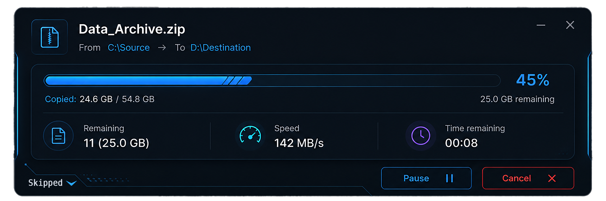
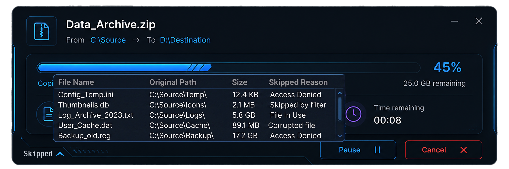
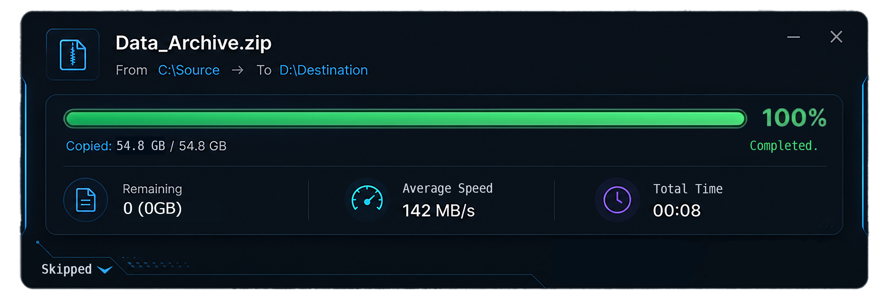

# 🚀 RoboCopyUI

<div align="center">


### *Next-Gen, High-Performance File Transfer GUI for Windows*

[](https://dotnet.microsoft.com/)
[](https://www.microsoft.com/windows)
[](https://learn.microsoft.com/en-us/dotnet/desktop/wpf/)
[](https://github.com/tusharrkabir/RoboCopyUI/releases)
[](LICENSE)

<br/>

**RoboCopyUI** transforms Windows' enterprise-grade command-line tool `robocopy.exe` into a sleek, modern, cyberpunk-styled desktop utility. Experience lightning-fast multi-threaded copies, live MB/s telemetry, file conflict scanning, and lightning-fast directory purging without ever touching a command prompt.

</div>

---

## 📸 Interface Preview

### ⚡ Active High-Speed Transfer
> Real-time progress with dynamic neon gradient bar, transfer velocity (MB/s), remaining count, and countdown ETA.

<div align="center">
  
</div>

<br/>

### 📂 Interactive Skipped Files Drawer & Transfer Complete
| 🔍 Skipped Files Drawer | ✅ Transfer Finished |
| :---: | :---: |
|  |  |
| *View exact reasons why files were skipped (Access Denied, In-Use, Corrupted, Filtered).* | *Accurate summary with total transfer time, average speed, and bytes transferred.* |

---

## ✨ Key Features

- **⚡ Enterprise-Grade Multi-Threading (`/MT`)**:
  - Leverages native `robocopy.exe` with optimized thread configurations tailored for NVMe SSDs, HDDs, and network shares (SMB/NAS).
- **🎨 Modern Dark & Cyberpunk Aesthetics**:
  - Custom WPF styling with glowing neon indicators, sleek dark glass acrylic backgrounds, and window blur effects (`WindowBlurHelper`).
- **📊 Real-Time Telemetry & Instant ETA**:
  - Rolling-average speed calculator (`SpeedCalculator.cs`) and dynamic time-to-completion estimator (`EtaEstimator.cs`).
- **🔍 Real-Time Skipped Files Inspector**:
  - Expandable drawer tracks every file skipped during transfer with live classification (Permission errors, file locks, filters, or corruption).
- **⚔️ Collision Scanner & Smart Renaming**:
  - Pre-scans source and destination to detect file collisions before starting and applies automatic collision renaming policies (`CollisionRenamer.cs`).
- **🗑️ Turbo Fast Delete (RoboDelete)**:
  - Deletes millions of nested directories and deep file trees in seconds using the Robocopy mirror purge technique, bypassing Windows Explorer lockups.
- **🖱️ Windows Shell Integration**:
  - Optional Windows Explorer context menu integration (`ShellRegistry.cs`) for seamless right-click paste & copy operations.
- **🌓 Theming System**:
  - Built-in `DarkTheme`, `LightTheme`, and `MidnightTheme` resource dictionaries (`ThemeManager.cs`).

---

## 🛠️ Architecture & Under the Hood

```
┌────────────────────────────────────────────────────────┐
│                   RoboCopyUI (WPF)                     │
│    MainWindow.xaml / SettingsWindow.xaml / Themes      │
└───────────────────────────┬────────────────────────────┘
                            │
       ┌────────────────────┼────────────────────┐
       ▼                    ▼                    ▼
┌──────────────┐   ┌─────────────────┐   ┌────────────────┐
│ PreScan &    │   │ RobocopyEngine  │   │  RoboDelete    │
│ Collision    │   │  (Process I/O   │   │  Runner        │
│ Detection    │   │  Streaming)     │   │  (Fast Purge)  │
└──────────────┘   └────────┬────────┘   └────────────────┘
                            │ Stdout Stream
                            ▼
           ┌────────────────────────────────┐
           │      Telemetry & Parsing       │
           │  • StdoutParser.cs             │
           │  • AccurateProgressTracker.cs  │
           │  • SpeedCalculator.cs          │
           │  • EtaEstimator.cs             │
           └────────────────────────────────┘
```

---

## 💻 Tech Stack & Requirements

| Component | Specification |
| :--- | :--- |
| **Operating System** | Windows 10 (Build 19041+) / Windows 11 (64-bit) |
| **Runtime Target** | [.NET 10.0](https://dotnet.microsoft.com/download/dotnet/10.0) (`net10.0-windows`) |
| **UI Framework** | Windows Presentation Foundation (WPF) + Windows Forms interop |
| **IDE Supported** | Visual Studio 2022 (v17.12+) / JetBrains Rider / VS Code with C# Dev Kit |
| **Engine** | Microsoft Windows Native `robocopy.exe` |

---

## 🚀 Getting Started for Developers

### 1. Clone the Repository
```bash
git clone https://github.com/tusharrkabir/RoboCopyUI.git
cd RoboCopyUI
```

### 2. Open in Visual Studio
Double-click `RoboCopyUI.slnx` or `RoboCopyUI.csproj` to load the solution in **Visual Studio 2022**.

*Ensure the **.NET Desktop Development** workload is installed in your Visual Studio Installer.*

### 3. Build & Run via .NET CLI
You can also build and run directly from the command line:

```powershell
# Restore dependencies and build
dotnet build

# Launch the application
dotnet run --project RoboCopyUI.csproj
```

### 4. Publishing a Self-Contained Binary
To publish a portable single-file executable for distribution:

```powershell
dotnet publish -c Release -r win-x64 --self-contained true -p:PublishSingleFile=true
```

---

## 📁 Project Structure

```plaintext
RoboCopyUI/
├── Assets/                 # Application icons and branding graphics
├── core/                   # Core business logic & native system services
│   ├── ClipboardManager.cs # Clipboard monitoring & folder path handling
│   ├── DriveTypeDetector.cs# Identifies SSD, HDD, USB, Network drives for thread tuning
│   ├── NotificationService.cs # Native toast notifications
│   ├── RoboDeleteRunner.cs # Superfast directory deletion via robocopy mirror trick
│   ├── RobocopyEngine.cs   # Robocopy process management & command builder
│   ├── ShellRegistry.cs    # Windows Explorer context menu registration
│   ├── ThemeManager.cs     # Dynamic runtime theme switcher
│   └── WindowBlurHelper.cs # Acrylic / Mica backdrop blur effects
├── models/                 # Data contracts, parsers & telemetry calculators
│   ├── AccurateProgressTracker.cs # High-fidelity progress synchronization
│   ├── CollisionScanner.cs # Pre-copy collision & overwrite scanner
│   ├── EtaEstimator.cs     # Exponential moving average ETA calculation
│   ├── RobocopyLineParser.cs # Real-time line-by-line CLI parser
│   └── SpeedCalculator.cs  # Multi-sample bandwidth speed calculation
├── Themes/                 # WPF XAML themes (Dark, Light, Midnight)
├── docs/                   # Documentation and high-resolution screenshots
├── App.xaml / App.xaml.cs  # Application entrypoint & single-instance handler
├── MainWindow.xaml (.cs)   # Primary dashboard UI and real-time visualizer
├── SettingsWindow.xaml(.cs)# Advanced configurations, thread tuning & presets
├── RoboCopyUI.csproj       # Project build definition (.NET 10 WPF)
├── RoboCopyUI.slnx         # Solution definition
└── .gitignore              # Ignores build artifacts (bin/obj), setups, and VS cache
```

---

## 🤝 Contributing

Contributions, feature requests, and bug reports are welcome!
1. Fork the Project (`https://github.com/tusharrkabir/RoboCopyUI/fork`)
2. Create your Feature Branch (`git checkout -b feature/AmazingFeature`)
3. Commit your Changes (`git commit -m "Add some AmazingFeature"`)
4. Push to the Branch (`git push origin feature/AmazingFeature`)
5. Open a Pull Request

---

## 📄 License

Distributed under the **MIT License**. See [`LICENSE`](LICENSE) for more information.

---

<div align="center">
Made with ❤️ by <a href="https://github.com/tusharrkabir"><b>Tushar</b></a> (MT Electronics)
</div>
