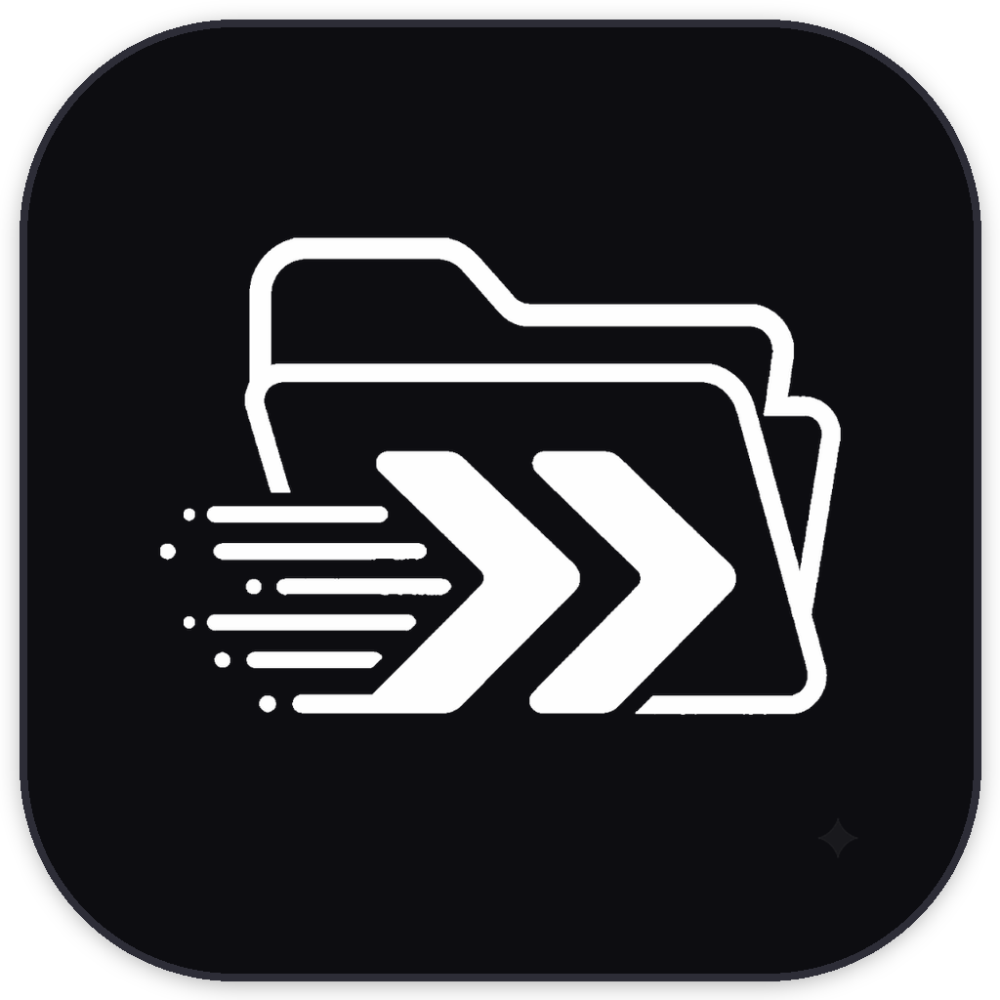
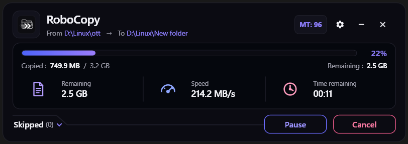
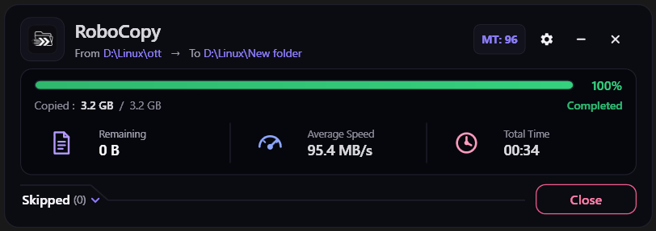
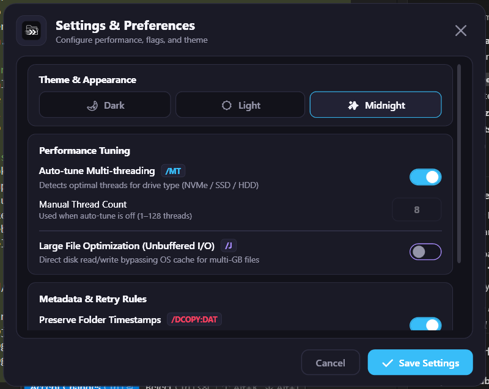
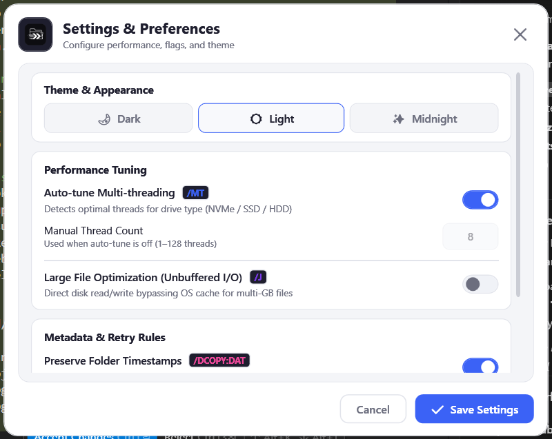
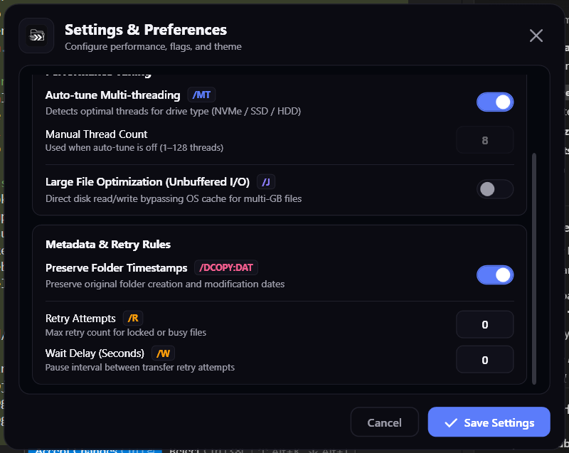

# 🚀 RoboCopyUI

<div align="center">



### *Next-Gen, Ultra-Fast Multi-Threaded File Transfer GUI for Windows*

[](https://dotnet.microsoft.com/)
[](https://www.microsoft.com/windows)
[](https://github.com/tusharrkabir/RoboCopyUI)
[](https://github.com/tusharrkabir/RoboCopyUI)
[](LICENSE)

<br/>

**RoboCopyUI** transforms Windows' legendary enterprise-grade copying tool (`robocopy.exe`) into an ultra-modern, high-velocity desktop application. Built specifically to eliminate the notorious Windows Explorer slowdowns on massive folders and millions of tiny files.

</div>

---

## 📸 Interface & Live Showcase

### ⚡ Active High-Speed Transfer (Real-Time 214+ MB/s)
> Live progress showing sustained **214.2 MB/s** velocity with **MT: 96** parallel threads, countdown ETA, and real-time bytes transferred.

<div align="center">
  
</div>

<br/>

### ✅ Transfer Completed in 34 Seconds
> **3.2 GB** transferred in just **34 seconds** with a **95.4 MB/s** average speed across multi-threaded operations.

<div align="center">
  
</div>

---

## 🎨 Themes & Customization

RoboCopyUI includes an integrated theme engine supporting **Midnight (Cyber Dark)**, **Clean Light**, and **Classic Dark** modes:

| 🌌 Midnight Theme | ☀️ Clean Light Theme | 🌙 Classic Dark Theme |
| :---: | :---: | :---: |
|  |  |  |
| *High-contrast cyberpunk glow* | *Modern, clean daytime aesthetics* | *Sleek, deep neutral dark mode* |

---

## 🔥 Why RoboCopyUI? (Windows Explorer vs RoboCopyUI)

Anyone who has tried copying `node_modules`, Python virtual environments, Git repos, or massive game assets knows the pain: **standard Windows Explorer takes an eternity on small chunk files**.

Windows Explorer copies files sequentially (single-threaded). When transferring thousands of tiny files, the filesystem metadata overhead causes transfer speeds to drop to a crawl—sometimes KB/s or freezing completely.

### ⚡ RoboCopyUI Solves This Forever:

| Feature | Standard Windows Copy | 🚀 RoboCopyUI |
| :--- | :---: | :---: |
| **Concurrency** | ❌ Single-threaded (1 file at a time) | ⚡ **Up to 128 Parallel Worker Threads (`/MT:128`)** |
| **Small Files / Chunks (`node_modules`, source code)** | 🐢 **Takes an eternity** (speed drops to KB/s) | 🚀 **Blasts at maximum drive bandwidth (200+ MB/s)** |
| **Drive Hardware Detection** | ❌ Generic copy handler | 🤖 **Smart Auto-Tuner (Tailors threads for NVMe / SSD / HDD)** |
| **Multi-GB Large Files** | ⚠️ Floods Windows OS RAM cache | 🏎️ **Large File Optimization (`/J` Unbuffered Direct I/O)** |
| **Locked / In-Use Files** | ❌ Halts entire transfer with modal error | 🛡️ **Zero-halt retry engine (`/R:0 /W:0` fully customizable)** |
| **Folder Purging / Deletion** | ⏳ Explorer locks up on deep directories | 🗑️ **Turbo RoboDelete (purges 100,000s files in seconds)** |
| **Visual Telemetry** | 📉 Fluctuating, inaccurate estimate | 📊 **Accurate rolling MB/s speed & dynamic ETA** |
| **Explorer Integration** | Default | 🖱️ **Context Menu integration (Right-click RoboCopy / RoboCut / RoboPaste)** |

---

## ✨ Key Features Breakdown

### 1. 🚀 Extreme Multi-Threading (Up to 128 Threads)
- Configure anywhere from **1 to 128 parallel threads** (`/MT`).
- Small files, deep folder hierarchies, and fragmented assets are transferred concurrently instead of waiting one by one.
- **Smart Auto-Tune**: Automatically probes drive hardware types (NVMe PCIe SSD, SATA SSD, Spinning HDD, or Network SMB share) and applies the optimal thread ceiling to prevent disk thrashing.

### 2. 🏎️ Large File Optimization (`/J` Unbuffered I/O)
- Switches to unbuffered direct I/O for multi-GB files (ISOs, virtual disks, 4K raw video).
- Bypasses the Windows file system cache directly to physical storage, preserving your system RAM and avoiding cache thrashing.

### 3. 🛡️ Fault Tolerance & Custom Retry Rules (`/R` & `/W`)
- Configure exact retry attempts and wait delay intervals for locked, busy, or permission-restricted files.
- Never wake up to a transfer that halted at 3 AM because a single temp file was open in another app.

### 4. 🗑️ Turbo Fast Delete (RoboDelete)
- Deleting deep directory trees in Windows Explorer can take 20+ minutes while Explorer calculates size.
- RoboCopyUI uses the **Robocopy Mirror Purge** technique to eradicate hundreds of thousands of files and directories in seconds.

### 5. 🔍 Interactive Skipped Files Inspector
- Keep track of every file skipped with live classification:
  - *Access Denied*
  - *File In Use*
  - *Corrupted File*
  - *Filtered by Pattern*

### 6. ⚔️ Collision Scanner & Smart Renaming
- Pre-scans source and destination to detect file collisions before starting.
- Options for automatic collision renaming, overwriting, or skipping.

---

## 🛠️ Architecture & Under the Hood

```
┌────────────────────────────────────────────────────────┐
│                   RoboCopyUI (WPF)                     │
│    MainWindow.xaml / SettingsWindow.xaml / Themes      │
└───────────────────────────┬────────────────────────────┘
                            │
       ┌────────────────────┼────────────────────┐
       ▼                    ▼                    ▼
┌──────────────┐   ┌─────────────────┐   ┌────────────────┐
│ PreScan &    │   │ RobocopyEngine  │   │  RoboDelete    │
│ Collision    │   │  (Process I/O   │   │  Runner        │
│ Detection    │   │  Streaming)     │   │  (Fast Purge)  │
└──────────────┘   └────────┬────────┘   └────────────────┘
                            │ Real-time Stdout Stream
                            ▼
           ┌────────────────────────────────┐
           │      Telemetry & Parsing       │
           │  • StdoutParser.cs             │
           │  • AccurateProgressTracker.cs  │
           │  • SpeedCalculator.cs          │
           │  • EtaEstimator.cs             │
           └────────────────────────────────┘
```

---

## 💻 Tech Stack & Requirements

| Component | Specification |
| :--- | :--- |
| **Operating System** | Windows 10 (Build 19041+) / Windows 11 (64-bit) |
| **Runtime Target** | [.NET 10.0](https://dotnet.microsoft.com/download/dotnet/10.0) (`net10.0-windows`) |
| **UI Framework** | Windows Presentation Foundation (WPF) + Windows Forms interop |
| **IDE Supported** | Visual Studio 2022 (v17.12+) / JetBrains Rider / VS Code |
| **Engine** | Microsoft Windows Native `robocopy.exe` |

---

## 🚀 Getting Started for Developers

### 1. Clone the Repository
```bash
git clone https://github.com/tusharrkabir/RoboCopyUI.git
cd RoboCopyUI
```

### 2. Open in Visual Studio
Open `RoboCopyUI.slnx` or `RoboCopyUI.csproj` in **Visual Studio 2022**.

*Ensure the **.NET Desktop Development** workload is installed.*

### 3. Build & Run via CLI
```powershell
# Restore & build
dotnet build

# Launch the application
dotnet run --project RoboCopyUI.csproj

# Launch Settings Window directly
dotnet run --project RoboCopyUI.csproj --settings
```

### 4. Publish a Portable Executable
To generate a single-file, self-contained executable:
```powershell
dotnet publish -c Release -r win-x64 --self-contained true -p:PublishSingleFile=true
```

---

## 📁 Project Structure

```plaintext
RoboCopyUI/
├── Assets/                 # Application icons and branding graphics
├── core/                   # Core business logic & native system services
│   ├── ClipboardManager.cs # Clipboard monitoring & folder path handling
│   ├── DriveTypeDetector.cs# Identifies SSD, HDD, USB, Network drives for thread tuning
│   ├── NotificationService.cs # Native toast notifications
│   ├── RoboDeleteRunner.cs # Superfast directory deletion via robocopy mirror trick
│   ├── RobocopyEngine.cs   # Robocopy process management & command builder
│   ├── ShellRegistry.cs    # Windows Explorer context menu registration
│   ├── ThemeManager.cs     # Dynamic runtime theme switcher
│   └── WindowBlurHelper.cs # Acrylic / Mica backdrop blur effects
├── models/                 # Data contracts, parsers & telemetry calculators
│   ├── AccurateProgressTracker.cs # High-fidelity progress synchronization
│   ├── CollisionScanner.cs # Pre-copy collision & overwrite scanner
│   ├── EtaEstimator.cs     # Exponential moving average ETA calculation
│   ├── RobocopyLineParser.cs # Real-time line-by-line CLI parser
│   └── SpeedCalculator.cs  # Multi-sample bandwidth speed calculation
├── Themes/                 # WPF XAML themes (Dark, Light, Midnight)
├── docs/screenshots/       # High-resolution real UI screenshots
├── App.xaml / App.xaml.cs  # Application entrypoint & CLI argument router
├── MainWindow.xaml (.cs)   # Primary dashboard UI and real-time visualizer
├── SettingsWindow.xaml(.cs)# Advanced configurations, thread tuning & presets
├── RoboCopyUI.csproj       # Project build definition (.NET 10 WPF)
├── RoboCopyUI.slnx         # Visual Studio Solution definition
└── .gitignore              # Ignores build artifacts (bin/obj), setups, and VS cache
```

---

## 🤝 Contributing

Contributions, issues, and feature requests are welcome!
1. Fork the Repository
2. Create your Feature Branch (`git checkout -b feature/NewFeature`)
3. Commit your Changes (`git commit -m "Add some NewFeature"`)
4. Push to the Branch (`git push origin feature/NewFeature`)
5. Open a Pull Request

---

## 📄 License

Distributed under the **MIT License**. See [`LICENSE`](LICENSE) for more information.

---

<div align="center">
Made with ❤️ by <a href="https://github.com/tusharrkabir"><b>Tushar</b></a> (MT Electronics)
</div>
